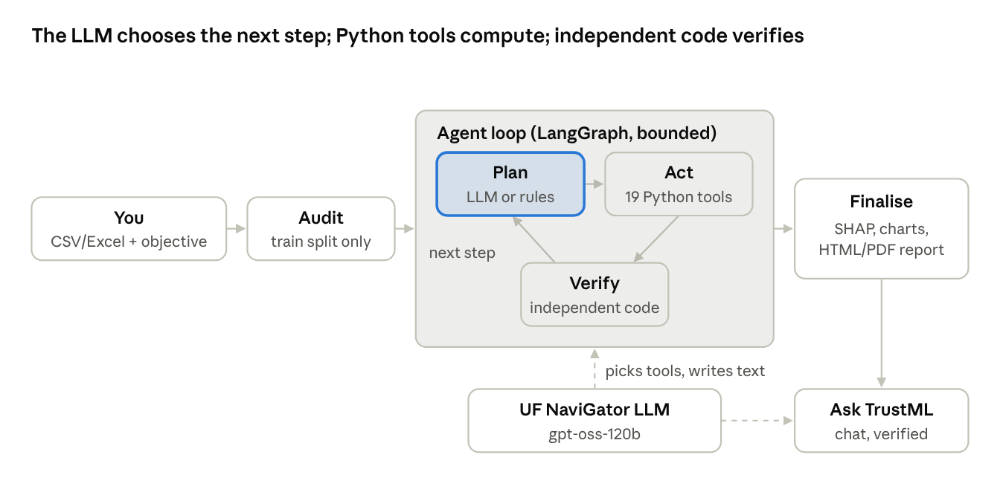
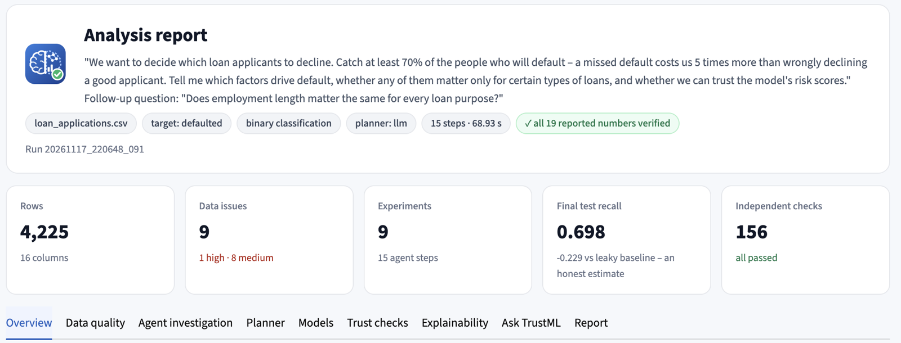
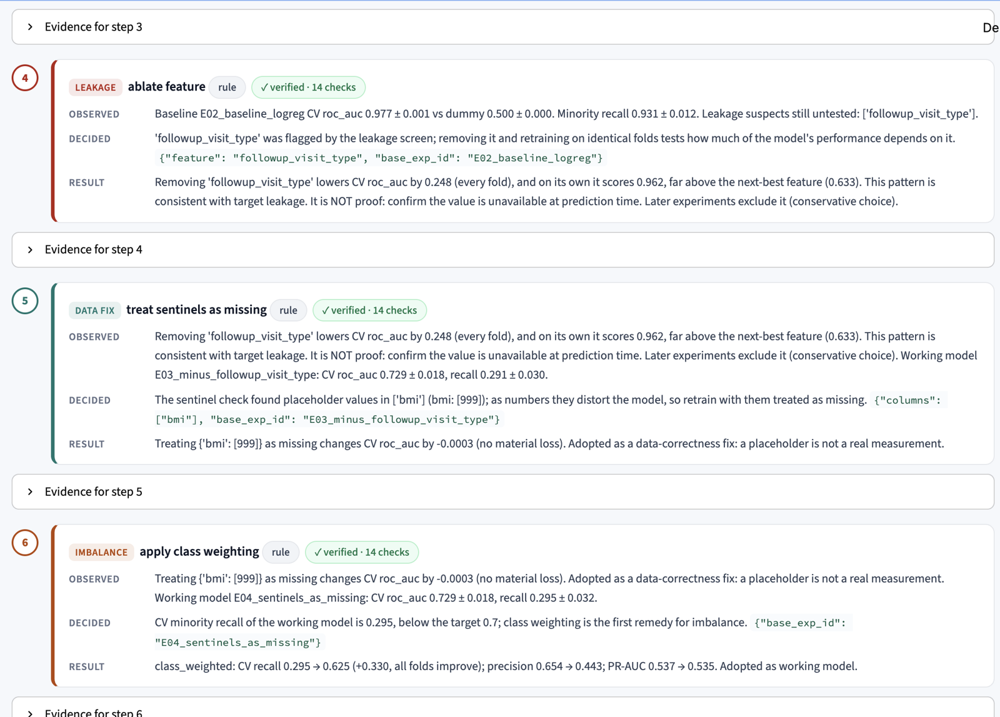
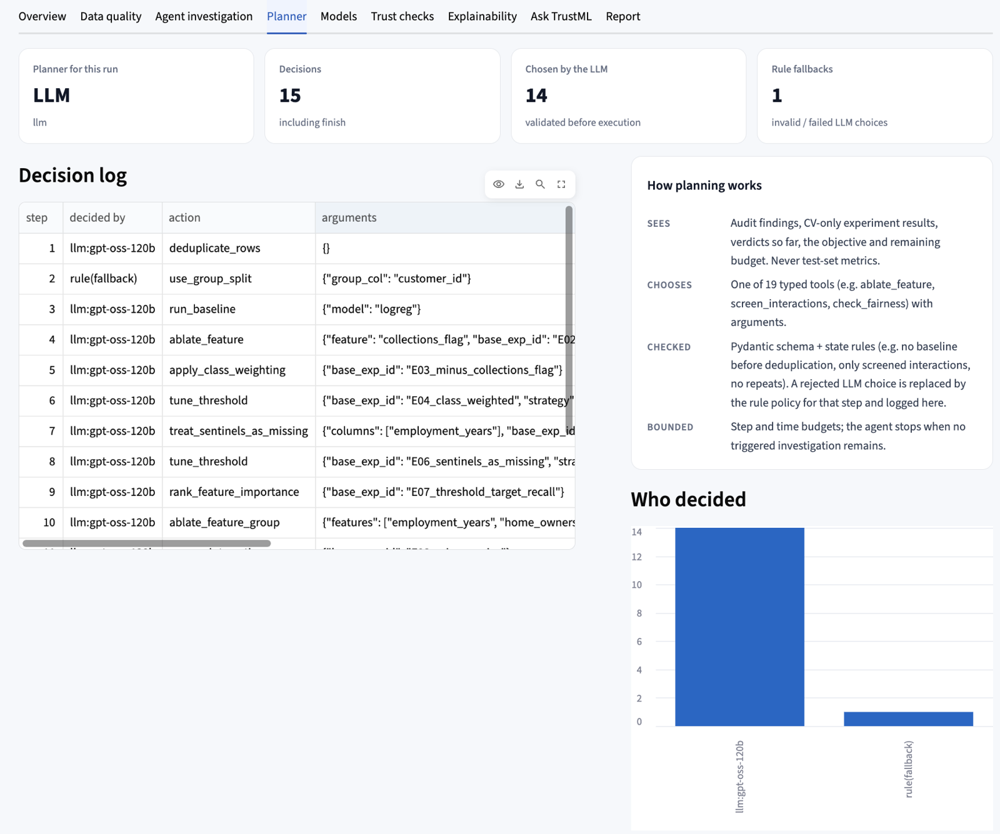
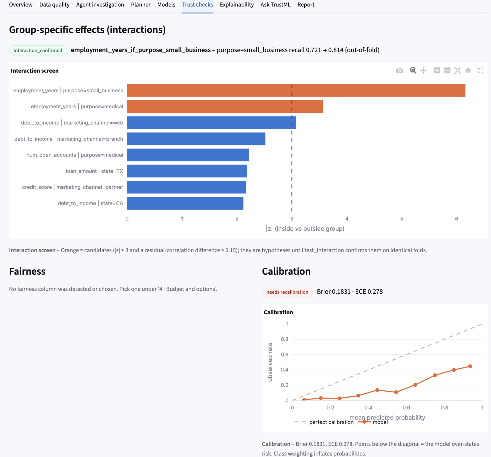
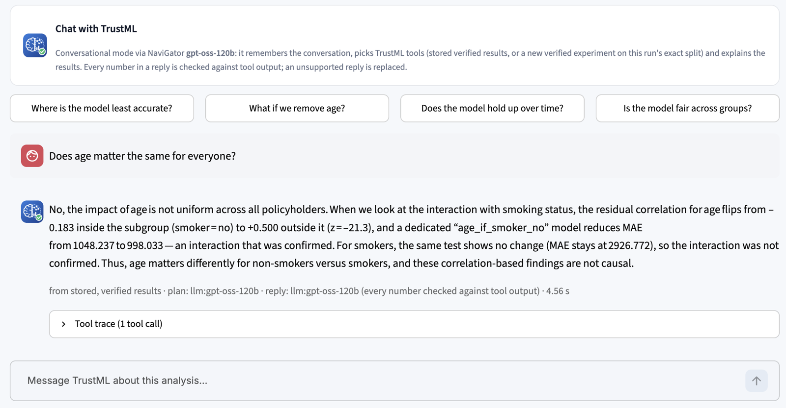

<p align="center">
  
</p>

<h1 align="center">TrustML</h1>

<p align="center">An AI agent that investigates tabular data like a careful data scientist, and checks every number it reports.</p>

---

## Why I built this

If you hand a spreadsheet to an AI assistant today, you usually get a confident answer back. The trouble is that a confident answer is not the same as a correct one. While working with real datasets, I kept running into the same problems:

- A column that was recorded *after* the outcome quietly gives the answer away, so the model looks almost perfect (target leakage).
- The same customer or patient appears in both the training and test data, which inflates every score.
- Placeholder codes like -1 or 999 get treated as real numbers.
- An effect exists only inside one group, so a single model-wide pattern hides it.
- Metrics get reported with no way to check where they came from.

TrustML is my attempt at an analyst that does not cut those corners. It audits the data, decides what to investigate next based on what it has just seen, runs controlled experiments, and only reports numbers that an independent piece of code has recomputed.

I built it as my term project for an Agentic AI course at the University of Florida.

## What it does

Give TrustML a CSV or Excel file, the column you want to predict, and a plain-English objective such as:

> "Catch at least 70% of the people who will default. A missed default costs us 5 times more than wrongly declining a good applicant."

It then works through the problem on its own:

- **Audits the data** for duplicates, repeated IDs, placeholder values, informative missing values, outliers, class imbalance and suspicious columns, using the training split only.
- **Investigates with 19 tools**, including leakage ablation, group-aware splits, class weighting, cost-aware thresholds, noise-feature removal, engineered features, interaction tests, model comparison, subgroup errors, fairness, calibration and drift over time.
- **Keeps a change only if it holds up**: every experiment is compared with its parent on identical cross-validation folds, and the untouched test set is scored once at the very end.
- **Verifies everything**: separate NumPy code recomputes every reported metric and every number in the summary. If an LLM-written sentence contains a number that is not in the verified results, the sentence is thrown away.
- **Explains the result** with SHAP, purposeful charts, an HTML/PDF report and an evidence pack, and answers follow-up questions in a chat that can run new, verified what-if experiments.

It reads goals and costs straight from the objective ("catch at least 70%", "costs 5 times more") and tells you that it did.

## How it works

<p align="center">
  
</p>

TrustML is a single orchestrating agent built as a plan, act, verify loop in LangGraph.

| Part | What it does |
|---|---|
| Planner | Chooses the next tool. It can be an LLM (gpt-oss-120b through the UF NaviGator Toolkit) or a deterministic rule policy. It sees audit findings and cross-validation results, never the test scores. |
| Tools | Plain Python that does all the calculation: cleaning, experiments, metrics, charts. |
| Verifier | Independent code that recomputes each result before the agent moves on. |
| Reporter and chat | Builds the report and evidence pack, and answers questions using only verified results. |

A few rules keep the LLM honest. Every action it proposes is a typed Pydantic schema, and it is checked against the state of the run before anything executes. If the choice is invalid (for example, training a baseline before removing duplicates), the rule policy takes that step instead and the switch is logged. Runs are bounded at 22 steps or 10 minutes.

I kept it to one agent on purpose. The roles above are components with clear contracts, and splitting them into several agents would have added coordination problems without adding capability.

## Screenshots

**Run overview**



**Each step shows what the agent observed, what it decided, the result, and whether it was verified**



**Which planner made each decision**



**Trust checks: a group-specific effect confirmed, and a calibration warning**



**Asking follow-up questions**



## Getting started

You need Python 3.10 or newer.

```bash
git clone https://github.com/YOUR_GITHUB_USERNAME/trustml.git
cd trustml
python -m venv .venv
source .venv/bin/activate          # on Windows: .venv\Scripts\activate
pip install -r requirements.txt
```

The rule-based planner works without any API key. To use the LLM planner and the conversational chat, copy the example environment file and add your key:

```bash
cp .env.example .env
# then edit .env and set NAVIGATOR_TOOLKIT_API_KEY
```

Never commit your `.env` file. It is already listed in `.gitignore`.

### Run the dashboard

```bash
python -m streamlit run app.py
```

Then open http://localhost:8501, pick a dataset (or one of the included benchmarks), choose the target column, write your objective, choose a planner and click **Run investigation**. A run usually takes between 15 seconds and 2 minutes.

Using `python -m streamlit` makes sure the Streamlit inside your virtual environment is the one that runs.

### Run from the command line

```bash
python scripts/run_agent.py data/benchmarks/loan_applications.csv \
  --target defaulted \
  --objective "Catch at least 70% of defaulters. A missed default costs 5 times more than a wrong decline." \
  --planner rule
```

Useful options: `--planner llm`, `--group-col customer_id`, `--fairness-col region`, `--cv-repeats 3`, `--max-steps 22`, `--no-report`. Each run is saved under `runs/` with its steps, experiments, charts and report.

### Run the tests

```bash
python -m pytest -q
```

There are 124 tests. They take about 10 minutes, mostly because many of them run the full agent end to end.

## How I tested it

Unit tests were not enough to convince me the agent actually worked, so I also built **blind tests**: synthetic datasets where I planted specific problems and wrote down an answer key *before* TrustML ever saw the data. The generators are in `benchmarks/` and the datasets with their answer keys are in `data/benchmarks/`.

| Blind test | Task | Result |
|---|---|---|
| Loan defaults | Classification, 11 planted facts | 5 found at first; 8 after fixes; the remaining interaction is now found too |
| Hospital readmission | Classification, 10 planted facts | 4 of 10 found blind. A leaking column scored just under my threshold and hid two other findings. After three general fixes, 10 of 10 (no longer blind) |
| Insurance claim cost | Regression, 11 planted facts | 10 of 11 found by both planners. It missed a BMI feature (weight divided by height squared) |

I also compared TrustML with Meta's Muse agent on the same three prompts, with the same files, the exact same wording and one attempt each, scored against the answer keys.

The honest result: on finding the planted problems, they were comparable, 29 versus 28 out of 31. Muse found the BMI effect that TrustML missed, and its answers read more like an analyst's memo. Where TrustML was clearly stronger was trust. All of its numbers are recomputed automatically (156 to 175 checks per run). When I checked 19 counts from Muse's answers against the raw data, six were slightly off because they had been counted before the duplicates Muse said it had removed.

## Project structure

```
trustml/
├── app.py                 Streamlit dashboard
├── trustml/
│   ├── agent/             planner (LLM and rules), action schemas, the agent loop
│   ├── tools/             profiling, quality checks, leakage, importance, features, diagnostics
│   ├── experiments.py     splits, cross-validation, experiment tracking
│   ├── verify.py          independent recomputation of every reported number
│   ├── explain.py         SHAP explanations
│   ├── charts.py          purposeful charts
│   ├── report.py          HTML report and evidence pack
│   ├── chat.py            conversational follow-up questions
│   └── followup.py        the tools the chat can call
├── scripts/               command-line runner, audit, benchmark and LLM check
├── benchmarks/            generators for the synthetic datasets
├── data/benchmarks/       datasets and their answer keys
├── tests/                 pytest suite
├── docs/images/           screenshots and architecture diagram
└── assets/                logo
```

## Limitations

I would rather be upfront about these:

- It handles single tables only: no time-series forecasting, text, images or deep learning.
- Model settings are fixed. There is no hyperparameter tuning.
- Feature engineering covers simple transforms, products, ratios and one interaction per run, which is why it missed BMI.
- Leakage, noise and fairness verdicts are evidence for a person to confirm, not proof.
- The LLM planner is slower than the rule planner and sometimes repeats steps. Validation catches invalid choices, but not wasted ones.
- SHAP describes what the model relies on, not what causes the outcome.

## What I would do next

- Search squared and power features, so it catches things like BMI.
- Add a recalibration step for risk scores.
- Stop the LLM planner from repeating actions earlier.
- Try it on real datasets together with people who know the domain.

## Acknowledgments

The LLM planner and chat use the UF NaviGator Toolkit. The rest of the stack is open source: LangGraph, Pydantic, pandas, scikit-learn, SciPy, SHAP, Matplotlib, Plotly, Jinja2 and Streamlit.

## License

MIT. See [LICENSE](LICENSE).
